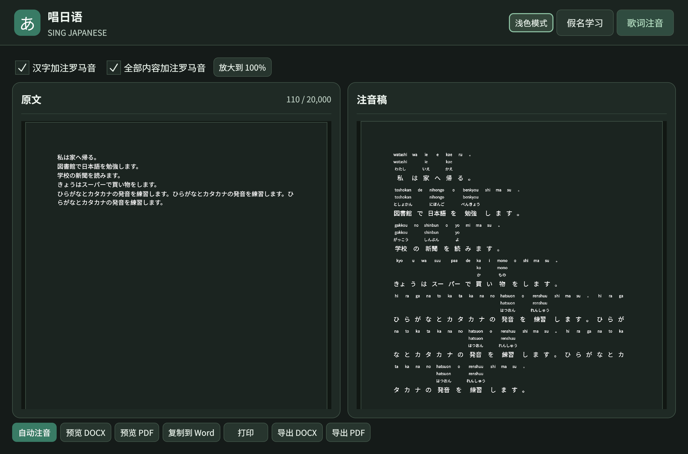

# 唱日语

[](https://github.com/luskyle/sing-japanese/actions/workflows/ci.yml)
[](https://github.com/luskyle/sing-japanese/actions/workflows/pages.yml)
[](https://github.com/luskyle/sing-japanese/releases/latest)

轻量离线日语桌面工具：一屏学习假名，为歌词和日语文本添加假名、罗马音，并导出排版一致的 DOCX / A4 PDF。
支持暖白、鼠尾草绿配色与深色模式，只有假名学习、歌词注音两个页面；无需账号，不上传文本。

**[项目网站](https://luskyle.github.io/sing-japanese/) · [下载安装包](https://github.com/luskyle/sing-japanese/releases/latest) · [反馈问题](https://github.com/luskyle/sing-japanese/issues)**

原名「假名小调」。提供 Windows、macOS 与 Ubuntu / Debian 发行包；使用 C++17、Qt 5 Quick/QML、Minizip 和 MeCab/IPADIC。
仓库地址与可执行文件名 `sing-japanese` 保持不变。

## 实际运行截图

以下为 Linux 下真实运行的桌面界面，点击图片可查看原图。

### 假名学习

全部 71 个假名自动分栏同屏展示，支持字形切换、分组筛选、罗马音开关和真人发音。

[](docs/assets/kana.png)

### 歌词注音

原文与 A4 注音稿并排显示，两种罗马音层独立叠加，预览、复制、导出按钮固定在底部。
截图使用日常日语示例文本。

[](docs/assets/annotation.png)

## 功能

- 平假名／片假名切换；清音、浊音、半浊音分类。
- 假名表根据窗口大小分栏，全部 71 个假名同屏展示，无需滚动；选中假名的发音信息显示在底部。
- 点击假名播放随程序打包的本地真人发音。
- 粘贴日语文本，使用本机 MeCab/IPADIC 标注振假名。
- 界面支持系统高 DPI 缩放，控件随窗口放大；选项自动换行，假名自动分栏，长文在纸张区域内滚动。
- 首次启动默认深色模式；右上角「深色模式 / 浅色模式」随时切换外观，重启后保留选择。原文与注音稿纸张也随主题切换，深色模式使用深底白字；打印、导出与复制到 Word 仍使用白底排版。
- 默认窗口为 1360 × 900 逻辑像素（小屏幕自动适配）。
- 窗口最小尺寸为 1120 × 800 逻辑像素，不能继续缩小；屏幕可用区域不足时，以下限不超过可用区域为准。系统高 DPI 缩放会自动换算为实际像素。
- 原文按 A4 页宽连续编辑；注音稿按 A4 纸张与 18 毫米页边距分页预览。正文使用 12 磅，注音使用 7.5 磅。
- 原文与注音稿占满可用高度，注音、预览、复制和导出按钮固定在页面底部；长文仅在纸张区域内滚动。
- 默认按面板宽度缩放纸张，可用「放大到 100% / 适合宽度」切换；页面缩放只影响屏幕显示，不影响导出字号、换行或分页。
- 注音稿按读音宽度自动留出原文间距，假名居中显示在对应汉字上方；行高随字体度量计算，避免上下行重叠。
- 罗马音注音单元之间额外留白，原文随注音宽度拉开并保持居中对应，避免相邻罗马音连在一起；预览与导出使用相同间距。
- 「汉字加注罗马音」在汉字读音上增加罗马音层；「全部内容加注罗马音」额外给汉字、平假名、片假名等内容加注罗马音。
  两项独立勾选、即时生效，均不替代原有假名；同时勾选时保留两个罗马音层。
- 保留输入中的标点、空格及换行；未知汉字词保留原文并以点线标记。
- 支持预览 DOCX、预览 PDF、导出 DOCX / PDF，以及复制全部注音稿到 Word。
- 注音完成后点击「打印」或按 `Ctrl+P`（macOS 为 `⌘P`），直接打开系统打印对话框，选择打印机、页码范围和份数。
- 不采集或保存学习记录。文档预览使用临时文件，正常退出时清理；导出的文件和剪贴板内容由用户管理。

注音采用词典中的常规读音，人名、造词、歧义用法及歌手特殊唱法可能不准确。
每次最多处理 20,000 个 Unicode 字符。预览与 PDF 都会利用原文中的假名定位读音，
例如「帰る」只在「帰」上方标注「かえ」。连续汉字词或无法唯一拆分的读音保留整词注音，
不猜测逐字读音。罗马音采用常见 Hepburn 拼写，长音以重复元音表示（例如「スーパー」为 `suupaa`）；
按词典识别的助词「は／へ／を」写作 `wa / e / o`，未知汉字不猜读音，在全文罗马音层显示 `?`。

### 文档预览与复制到 Word

1. 完成注音，勾选需要的罗马音层。改变选项无需重新注音；修改原文后必须重新注音才能预览、复制或导出。
2. 点击「预览 DOCX」或「预览 PDF」，程序生成当前结果的临时文档，并交给系统关联应用打开。
   DOCX 需要安装 Word、WPS 或 LibreOffice；PDF 需要 PDF 阅读器。预览文档是生成时的快照，改变内容后应再次预览。
3. 点击「复制到 Word」，在目标文档中以**保留源格式**粘贴；剪贴板同时提供包含全部页面的 HTML 和 RTF 图片内容。
   不要使用「仅保留文本」。不同编辑器对剪贴板格式支持不同；如不能粘贴图片，请直接使用「导出 DOCX」。

**DOCX 和复制内容采用 3 倍分辨率的图片式排版，文字不可单独编辑。** 它们与注音稿共用 A4 绘制器，
保留相同的换行、分页、所有注音层、字号比例与对齐；不依赖目标电脑的字体或 Word 对振假名的支持。
PDF 也使用同样的 A4 排版。极长且不可拆分的词组会等比缩小以免裁切。
导出文件可在程序退出后继续使用；预览临时文件不可作为永久保存。

### 打印

完成注音并选好罗马音层后，点击底部「打印」。程序直接调用系统打印对话框，无需先导出或打开阅读器。
打印与预览共用 A4 排版，保留注音对应关系、换行和分页；若打印机的可用区域较小，会等比缩小而不重新排版。
取消对话框不会发送打印任务。修改原文后需重新注音，才能打印新的内容。
实际纸张输出需要已安装并配置好的系统打印机；是否提供「打印到文件」由系统打印服务决定。

## 下载与安装

从 [最新 Release](https://github.com/luskyle/sing-japanese/releases/latest) 下载对应平台文件：

| 平台 | 文件 | 安装与运行 |
| --- | --- | --- |
| Windows 10 / 11 x64 | `sing-japanese-0.4.0-Windows-x86_64.zip` | 完整解压后运行 `SingJapanese/sing-japanese.exe` |
| macOS 12+ Intel | `sing-japanese-0.4.0-macOS-x86_64.dmg` | 打开 DMG，将「唱日语」拖入 Applications |
| Ubuntu / Debian x86_64 | `sing-japanese-0.4.0-Linux.deb` | 使用下面的 `apt` 命令安装 |

Windows 和 macOS 包内置 Qt、MeCab、UTF-8 IPADIC 和日语字体，不需要另外配置词典。
Windows / macOS 录音使用 PCM WAV，无需额外的 Ogg 解码器。**不要只复制 EXE 或应用包中的单个文件。**
Apple Silicon Mac 目前通过 Rosetta 2 运行 Intel 版；暂不提供原生 arm64 包。

Windows 包未签名，可能出现 SmartScreen 提示。macOS 包仅临时签名，未进行 Developer ID 签名或公证；
确认来自本仓库并校验文件后，可在「系统设置 → 隐私与安全性」中选择「仍要打开」，不要全局关闭 Gatekeeper。

### Ubuntu / Debian

从 [最新 Release](https://github.com/luskyle/sing-japanese/releases/latest) 下载 Debian 安装包后，在安装包所在目录执行：

```sh
sudo apt install ./sing-japanese-0.4.0-Linux.deb
sing-japanese
```

使用 `apt install ./包名.deb` 安装会一并安装运行依赖；不要只从包中提取可执行文件运行。
安装包本身约 2 MB，不包含系统 Qt 库和 IPADIC 词典，首次安装还需下载这些依赖。

Release 同时提供 `SHA256SUMS`。Linux 使用 `sha256sum --check SHA256SUMS --ignore-missing`；
macOS 使用 `shasum -a 256 文件名`；Windows PowerShell 使用 `Get-FileHash 文件名 -Algorithm SHA256`，与文件中对应条目比较。

如果直接运行自行编译的程序时出现 `libQt5Multimedia.so.5` 或 `libmecab.so.2` 缺失：

```sh
sudo apt install libqt5widgets5 libqt5multimedia5 libqt5multimedia5-plugins \
  libqt5printsupport5 libmecab2 libminizip1 mecab-ipadic-utf8 fonts-noto-cjk \
  gstreamer1.0-plugins-good qml-module-qtquick2 qml-module-qtquick-window2 \
  qml-module-qtquick-controls2 qml-module-qtquick-layouts
```

## 从源码构建

```sh
sudo apt install build-essential cmake qtbase5-dev qtdeclarative5-dev qtmultimedia5-dev \
  libqt5multimedia5-plugins libmecab-dev libminizip-dev mecab-ipadic-utf8 \
  fonts-noto-cjk gstreamer1.0-plugins-good qml-module-qtquick2 \
  qml-module-qtquick-window2 qml-module-qtquick-controls2 qml-module-qtquick-layouts
cmake -S . -B build -DCMAKE_BUILD_TYPE=Release
cmake --build build --parallel
./build/sing-japanese
```

如同时安装了 Conda 的 Qt，构建时可使用
`-DQt5_DIR=/usr/lib/x86_64-linux-gnu/cmake/Qt5 -DCMAKE_PREFIX_PATH=/usr`
选择系统 Qt，避免混用不同版本的库与 QML 插件。

Linux 默认构建使用系统 IPADIC，不复制进应用。
如果系统找不到词典，请确认 `mecab-ipadic-utf8` 已安装且 `/etc/mecabrc` 指向该词典。
Ogg 发音通过 Qt Multimedia / GStreamer 播放。首次播放时录音会从应用资源复制到用户缓存目录。

运行测试并生成 Debian 安装包：

```sh
ctest --test-dir build --output-on-failure
cd build
cpack -G DEB
```

Debian 包依赖 Qt 5、Minizip、MeCab/IPADIC、Noto CJK 字体和 GStreamer Ogg 插件。IPADIC 声明保存在
[`public/licenses/IPADIC-NOTICE.txt`](public/licenses/IPADIC-NOTICE.txt)。

### Windows / macOS 构建

完整依赖安装与原生打包命令见 [共用构建工作流](.github/workflows/build-desktop.yml)：
Windows 使用 MSVC、Qt 5.15.2、vcpkg 的 MeCab / Minizip 和 FFmpeg（仅构建时转换录音）；
macOS Intel 使用 Qt 5.15.2 与 Homebrew 的 MeCab / Minizip，以及仅构建时使用的 FFmpeg。

便携构建通过 `-DSING_JAPANESE_DICTIONARY=/绝对路径/ipadic` 指定编译好的 **UTF-8** IPADIC，
通过 `-DSING_JAPANESE_FONT=/绝对路径/NotoSansCJKjp-Regular.otf` 嵌入日语字体。
应用优先从随包资源加载词典，不依赖构建机器的 `mecabrc`。Windows / macOS 原生构建时需能找到 `ffmpeg`。

构建与测试后，分别运行 [Windows 打包脚本](packaging/package-windows.ps1) 或 [macOS 打包脚本](packaging/package-macos.sh)；
脚本部署 Qt/QML 插件和动态库、保留第三方许可，并对打包后的应用执行启动、注音、导出与音频服务冒烟测试。
命令行 `sing-japanese --smoke-test` 用于发行包验证，执行后自动退出，不保存用户内容。

## GitHub Pages 与 CI/CD

- [桌面 CI](.github/workflows/ci.yml)：推送到 `main`、提交 PR 或手动触发后，在 Linux、Windows、macOS 原生 runner 上构建，运行 UI 和文档测试，并上传对应发行包。
- [Pages 工作流](.github/workflows/pages.yml)：`docs/` 或站点工作流变更后自动校验并部署静态网站；PR 仅构建，不部署。网站地址为 <https://luskyle.github.io/sing-japanese/>。
- [Release 工作流](.github/workflows/release.yml)：推送 `vX.Y.Z` 标签后，核对标签与 CMake 版本；仅当三个平台均构建、测试、打包成功后，汇总 Debian、Windows ZIP、macOS DMG 与 SHA-256 校验文件，使用仓库中的[发版说明](.github/release-notes/v0.4.0.md)发布正式 Release。
  也可在 Actions 中手动指定已有版本标签重试；不会覆盖已正式发布的版本。

网站直接部署 [`docs/`](docs/)，无需 Node.js、第三方主题或外部字体。新仓库需在 Settings → Pages 中将 Source 设为 GitHub Actions。
发布新版本时，先更新 `CMakeLists.txt` 版本和安装示例，添加 `.github/release-notes/vX.Y.Z.md`，待主分支 CI 通过后再推送对应标签。

## 项目结构

```text
app/                 # C++ 状态与音频、MeCab 注音、罗马音、共享绘制与 DOCX/PDF
app/qml/             # QML 双页界面与控件
tests/               # QML 加载与交互、注音、原文保留及 PDF 导出测试
public/audio/        # 离线假名录音，通过 Qt 资源嵌入程序
public/licenses/     # 词典许可声明
docs/                # GitHub Pages 静态网站与真实运行截图
.github/workflows/   # 桌面 CI、Pages 部署与 Release 发布
```

歌词注音页支持 `Ctrl+Enter` 注音、`Ctrl+S` 导出当前结果。
修改原文后必须重新注音再导出；未知汉字词以点线标记。

发音录音来自 Wikimedia Commons，录音者为 Hakatanoshio117117，按 Public Domain 发布。
来源和逐条校验信息见 [音频资源说明](public/RESOURCE-LICENSE.md)。
